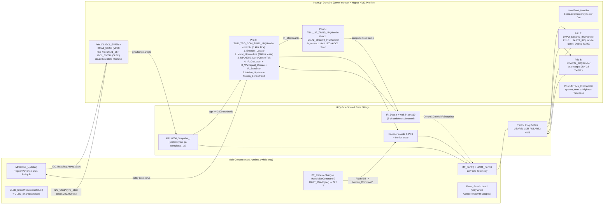

# Firmware System Codebase Graph — Micromouse STM32F411CEU6

> **Mục đích:** Bản đồ kiến trúc & phụ thuộc **chỉ cho mã nguồn hệ thống** (`src/` + `include/` + linker script) giúp AI Agent nắm trọn cấu trúc firmware và mở đúng 2–5 file cần thiết thay vì đọc toàn bộ dự án.
> **Nhánh:** `giomuadongbac` | **Baseline commit:** `3649fe0` | **Cập nhật:** 2026-11-24
> **Phạm vi:** 21 file `.c` lõi hệ thống (7.912 LOC) + header tương ứng + `ld/STM32F411CE_FLASH_256K.ld`. Loại trừ toàn bộ `tests/`, `tools/`, `web/` và 21 file `*_diag.c`/`*_test.c` trong `src/` (xem mục 5).
> **Build profile production (`platformio.ini`):** `genericSTM32F411CE` (mặc định, tắt OLED) và `production_oled_status_96m` (bật `OLED_SHARED_I2C=1`, `OLED_PRODUCTION_STATUS=1`).

---

## 1. Agent Task-Routing Table (Đọc đúng file cần thiết)

| Khi làm việc với phân hệ | Chỉ cần đọc các file này (Minimal Read Set) | Ghi chú ranh giới |
|---|---|---|
| **Boot, Main Loop & Mode Dispatch** | `src/main.c`, `src/main_runtime.c`, `src/board.c`, `include/pinout.h` | `main.c` chỉ rẽ nhánh `#ifdef`; vòng lặp production ở `main_runtime.c` |
| **Lập lịch 1 kHz (TIM11)** | `src/control.c`, `include/control.h` | Prio 0; tuyệt đối không gọi I2C/UART/Flash blocking trong ISR |
| **Hành vi chuyển động & PID** | `src/motion.c`, `src/motion_primitives.c`, `src/pid.c`, `include/motion.h` | `control.c` gọi `Motion_Update()` ở 1 kHz; lỗi IMU gọi `Motion_SensorFault()` |
| **Motor PWM & An toàn động cơ** | `src/motor.c`, `include/motor.h`, `include/pinout.h` | TIM2 30 kHz; lease 300 tick + ramp + reverse gap 30 ms; lock cứng bằng `Motor_LockOutputs()` |
| **Encoder hai bánh** | `src/encoder.c`, `include/encoder.h`, `include/pinout.h` | TIM3 (Phải) / TIM4 (Trái); `ENCODER_PPR=1430`; `Encoder_Update()` chạy trong TIM11 |
| **IR 6 kênh & Tín hiệu tường** | `src/ir_sensor.c`, `src/ir_wall_signal.c`, `include/ir_sensor.h`, `include/pinout.h` | TIM10 + ADC1 + DMA2_S0 bất đồng bộ; `control.c` cập nhật passive `wall_ir_ema10` |
| **MPU6050 & Bus I2C1 dùng chung** | `src/mpu6050.c`, `src/i2c.c`, `include/mpu6050_i2c_module.h`, `include/mpu_policy.h` | **Single-owner `I2C1`**; Policy B async IRQ tiến triển từ `main_runtime.c`, TIM11 chỉ notify + đọc snapshot |
| **OLED Production (Opt-in)** | `src/oled_shared.c`, `src/ssd1306.c`, `src/fonts.c`, `src/i2c.c` | Chỉ chạy main-context; nhường cửa sổ I2C1 cho MPU6050 (chỉ phát khi bus ≥300 kHz, trong slack 200–900 µs) |
| **Debug USART1 & BT USART2** | `src/uart.c`, `src/bt_debug.c`, `include/uart.h`, `include/bt_debug.h` | USART1 TX DMA2_S7 (1 KiB); USART2 TXE IRQ (4 KiB) cho JDY-33 BLE/Classic SPP |
| **Lưu trữ Flash (Sectors 6/7)** | `src/flash_storage.c`, `src/flash_record_format.c`, `include/flash_storage.h`, `ld/STM32F411CE_FLASH_256K.ld` | Ghi append-only 1 KiB/slot + CRC32; bắt buộc `Control_Stop()` + `Motor_LockOutputs()` + `IR_Stop()` trước khi ghi |

---

## 2. Graph 1 — Kiến trúc phân tầng & Phụ thuộc System Code (`src/`)

> Để tránh nhiễu sơ đồ, các **Foundation Headers** được hầu hết module include (`stm32f4xx.h`, `pinout.h`, `board.h`, `system_timer.h`) được tách riêng xuống tầng Platform thay vì vẽ mũi tên từ mọi node.

```mermaid
flowchart TD
    subgraph L0["1. Entry & Orchestration"]
        MAIN["main.c (39 LOC)\nCompile-time Dispatcher"]
        RUNTIME["main_runtime.c (796 LOC)\nBoot + while(1) + Telemetry"]
    end

    subgraph L1["2. Real-Time Scheduler & Behavior"]
        CTRL["control.c (322 LOC)\nTIM11 1 kHz ISR"]
        MOTION["motion.c (316 LOC)\nState Machine + Control Law"]
    end

    subgraph L2["3. Pure Math & Signal Modules (Hardware-free)"]
        MPRIM["motion_primitives.c (254 LOC)\nTurn/Straight Primitives"]
        PID["pid.c (53 LOC)\nReusable PID"]
        IRWALL["ir_wall_signal.c (92 LOC)\n6-ch EMA0.10 + Freshness"]
        FLFMT["flash_record_format.c (35 LOC)\nCRC32 Record Layout"]
    end

    subgraph L3["4. Peripheral & Subsystem Drivers"]
        MOTOR["motor.c (466 LOC)\nTIM2 30 kHz PWM + Lease"]
        ENC["encoder.c (365 LOC)\nTIM3/TIM4 Quadrature"]
        IR["ir_sensor.c (510 LOC)\nTIM10 + ADC1 + DMA2_S0"]
        MPU["mpu6050.c (983 LOC)\nAsync Policy B + Yaw/Temp"]
        I2C["i2c.c (1112 LOC)\nI2C1 Single Owner + Arbiter"]
        OLED["oled_shared.c (140 LOC)\nShared-I2C Dirty Scheduler"]
        SSD["ssd1306.c (906 LOC)\nFramebuffer + Renderer"]
        FONTS["fonts.c (322 LOC)\nBitmap Fonts"]
        UART["uart.c (380 LOC)\nUSART1 DMA TX + RX IRQ"]
        BT["bt_debug.c (168 LOC)\nUSART2 JDY-33 TXE/RX IRQ"]
        FLASH["flash_storage.c (347 LOC)\nInternal Flash Sectors 6/7"]
    end

    subgraph L4["5. Platform Foundation (Shared by All Layers)"]
        BOARD["board.c (238 LOC)\n96 MHz PLL + PA0/PC13 + HardFault"]
        TIMER["system_timer.c (68 LOC)\nTIM5 micros()/millis()"]
        PINOUT["include/pinout.h (216 LOC)\nFixed PCB Pin Mapping"]
        LD["ld/STM32F411CE_FLASH_256K.ld\n256 KiB ROM / 128 KiB RAM"]
    end

    MAIN --> RUNTIME

    RUNTIME --> CTRL
    RUNTIME --> MOTION
    RUNTIME --> MPU
    RUNTIME --> IR
    RUNTIME --> ENC
    RUNTIME --> MOTOR
    RUNTIME --> UART
    RUNTIME --> BT
    RUNTIME -. "OLED_PRODUCTION_STATUS" .-> OLED
    RUNTIME -. "OLED_PRODUCTION_STATUS" .-> SSD

    CTRL --> ENC
    CTRL --> MOTOR
    CTRL --> MPU
    CTRL --> IR
    CTRL --> IRWALL
    CTRL --> MOTION

    MOTION --> MPRIM
    MOTION --> PID
    MOTION --> ENC
    MOTION --> MOTOR

    MPU --> I2C
    OLED --> SSD
    OLED --> I2C
    OLED -. "window check" .-> MPU
    SSD --> I2C
    SSD --> FONTS

    FLASH --> FLFMT
    FLASH --> CTRL
    FLASH --> MOTOR
    FLASH --> UART
    FLASH -. "sector layout" .-> LD
```

---

## 3. Graph 2 — Biên giới Thời gian thực: Main Loop ↔ Snapshots ↔ 11 ISR

> Mọi luồng thời gian thực trao đổi qua **snapshot khóa ngắn (PRIMASK / seqlock)** để giữ `TIM11` (Prio 0) hoàn toàn xác định và không chặn bus.

**Thứ tự khởi động (Boot Order trong `Main_Runtime()`):**
`Board_Init()` → `SystemTimer_Init()` → `UART_Init()` → *(fail-closed nếu `Board_GetClockFault() != 0`, dừng trước `Motor_Init`)* → `Motor_Init()` → `Encoder_Init()` → `BT_Init()` → `IR_Init()` → `MPU6050_Init()` *(chủ trì probe I2C1)* → *(`OLED_PRODUCTION_STATUS`: `SSD1306_Init()` + splash + `OLED_SharedInit()`)* → `MPU6050_Calibrate()` → `Motion_Init()` → `IR_StartScan()` → `Control_Init()` → `Control_Start()`.

---

## 4. Quyền sở hữu Ngoại vi & Ràng buộc Bất biến (Hardware Ownership)

| Tài nguyên phần cứng | Chân / Địa chỉ / DMA / IRQ | Chủ sở hữu duy nhất | Ràng buộc bất biến |
|---|---|---|---|
| **RCC / PLL 96 MHz, PA0, PC13, HardFault** | HSI trim25, PLLM=16, PLLN=192, PLLP=2; APB1=48 MHz, APB2=96 MHz; PA0 btn, PC13 LED | `src/board.c` | Fail-closed trước `Motor_Init()` nếu lỗi clock; `HardFault_Handler` cắt motor tức thì |
| **TIM11 (Control 1 kHz)** | `TIM1_TRG_COM_TIM11_IRQn` (Prio 0) | `src/control.c` | Chỉ đọc snapshot; không chờ I2C, không `UART_Printf`, không chạm Flash |
| **TIM2 (Motor PWM 30 kHz)** | R: PA15 (CH1) + PB15/PB14; L: PB3 (CH2) + PB13/PB12 | `src/motor.c` | ARR tính động từ clock timer; lease 300 tick (`Motor_Update1ms`); dead-gap đảo chiều 30 ms |
| **TIM3 & TIM4 (Encoders)** | R: TIM3 PB4/PB5; L: TIM4 PB6/PB7 (`PPR=1430`) | `src/encoder.c` | Dấu tiến dương; cập nhật tại `TIM11` |
| **TIM10 + ADC1 + DMA2_S0 (6 IR)** | RX: PB1(L90), PB0(L45), PA6(L0), PA5(R0), PA4(R45), PA1(R90); TX: PA7, PB10, PB2, PA8, PA11, PA12; `TIM10` (Prio 1), `DMA2_S0` (Prio 2) | `src/ir_sensor.c` | Quét bất đồng bộ theo state machine; chỉ publish đủ 6 kênh đã trừ ambient |
| **I2C1 + DMA1_S0 (RX) + DMA1_S6 (TX)** | PB8 (SCL) / PB9 (SDA); MPU `0x68`, OLED `0x3C`; MPU IRQ Prio 2/3, OLED IRQ Prio 4/5 | `src/i2c.c` | **Cấm tạo chủ thứ hai cho I2C1**; MPU6050 ưu tiên tuyệt đối, OLED chỉ mượn bus qua `OLED_SharedService()` |
| **USART1 (Debug USB-TTL)** | PA9 TX (`DMA2_Stream7` Ch4, Prio 7), PA10 RX (`USART1_IRQn`, Prio 8), 115200 8N1 | `src/uart.c` | Hàng đợi TX 1024 B (production) / 2048 B (diag); RX 256 B |
| **USART2 (JDY-33 BLE/Classic SPP)** | PA2 TX / PA3 RX (`USART2_IRQn`, Prio 8), 115200 8N1 | `src/bt_debug.c` | TX ring 4096 B (TXE IRQ), RX ring 256 B; không đưa vào vòng PID 1 kHz |
| **TIM5 (System Timebase)** | `TIM5_IRQn` (Prio 14) | `src/system_timer.c` | Cung cấp `micros()`, `millis()`, wake timer; dùng rộng rãi làm timestamp |
| **Internal Flash (512 KiB)** | App: Sectors 0–5 (`0x08000000`, 256 KiB); Calib: Sector 6 (`0x08040000`); Map: Sector 7 (`0x08060000`) | `src/flash_storage.c` + `ld/STM32F411CE_FLASH_256K.ld` | Ghi append-only 1 KiB/slot (max 1000 B payload + CRC32); không tự xóa sector; phải khóa Control/Motor/IR trước khi ghi |

---

## 5. Danh mục 1 dòng System Files (`src/` + `include/`)

### A. 21 File `.c` Lõi Hệ Thống & Header Cặp

| Nhóm | File `.c` (LOC) | Header cặp / phụ | Phụ thuộc nội bộ chính | Vai trò cốt lõi |
|---|---|---|---|---|
| **Entry** | `src/main.c` (39) | *(dispatcher)* | `main_runtime.c` *(hoặc 11 diag mains)* | Điểm vào duy nhất, rẽ nhánh biên dịch theo macro `platformio.ini` |
| **Entry** | `src/main_runtime.c` (796) | *(calls core headers)* | `control`, `motion`, `mpu6050_i2c_module`, `ir_sensor`, `encoder`, `motor`, `uart`, `bt_debug`, `oled_shared` | Khởi tạo toàn hệ thống, vòng lặp `while(1)`, nhận lệnh BLE (`F/L/R/S/Z`) & UART (`S`/`?`), telemetry |
| **Platform** | `src/board.c` (238) | `include/board.h`, `pinout.h` | `stm32f4xx.h` | Cấu hình PLL 96 MHz (HSI trim25), đọc clock APB1/APB2, PA0/PC13, `HardFault_Handler` ngắt motor |
| **Platform** | `src/system_timer.c` (68) | `include/system_timer.h`, `mpu_policy.h` | `board.h` | Bộ đếm thời gian `TIM5` (`micros`/`millis`/wake) |
| **Control** | `src/control.c` (322) | `include/control.h` | `encoder`, `motor`, `mpu6050`, `ir_sensor`, `ir_wall_signal`, `motion` | Chủ sở hữu `TIM11` 1 kHz; lấy snapshot cảm biến, kiểm tra gyro ≤3 ms, gọi `Motion_Update()` |
| **Control** | `src/motion.c` (316) | `include/motion.h` | `motion_primitives`, `pid`, `encoder`, `motor` | Máy trạng thái `IDLE`/`STRAIGHT`/`TURN`, điều khiển đi thẳng & rẽ, xử lý `Motion_SensorFault()` |
| **Pure Math** | `src/motion_primitives.c` (254) | `include/motion_primitives.h` | *(không phụ thuộc HW)* | Thuật toán profile quỹ đạo/rẽ 90°/180° độc lập phần cứng |
| **Pure Math** | `src/pid.c` (53) | `include/pid.h` | *(không phụ thuộc HW)* | Bộ tính PID tái sử dụng (`PID_Init`, `PID_Reset`, `PID_Compute`) |
| **Pure Math** | `src/ir_wall_signal.c` (92) | `include/ir_wall_signal.h` | *(không phụ thuộc HW)* | Lọc EMA0.10 6 kênh IR thụ động trong `TIM11`, kiểm tra warmup & stale age |
| **Actuator** | `src/motor.c` (466) | `include/motor.h` | `board`, `pinout` | Driver cầu H `TIM2` 30 kHz, ramp PWM, lease 300 tick, dead-gap 30 ms, cơ chế khóa cứng output |
| **Sensor** | `src/encoder.c` (365) | `include/encoder.h` | `pinout` | Đọc quadrature `TIM3`/`TIM4`, tính vận tốc PPS & lọc LPF |
| **Sensor** | `src/ir_sensor.c` (510) | `include/ir_sensor.h` | `board`, `system_timer`, `pinout` | State machine `TIM10` + `ADC1` + `DMA2_S0` quét 6 cặp LED/RX trừ ánh sáng nền |
| **Sensor** | `src/mpu6050.c` (983) | `include/mpu6050.h`, `mpu6050_i2c_module.h`, `mpu_policy.h` | `i2c`, `system_timer` | Driver MPU6050 RC2 async Policy B, calibrate bias, tích phân yaw, đọc nhiệt độ, snapshot |
| **Bus** | `src/i2c.c` (1112) | `include/i2c.h` | `board`, `system_timer` | Chủ sở hữu duy nhất `I2C1` + `DMA1_S0/S6` + `I2C1_EV/ER`, trọng tài MPU/OLED, bus recovery |
| **Display** | `src/oled_shared.c` (140) | `include/oled_shared.h` | `ssd1306`, `i2c`, `mpu6050`, `system_timer` | Bộ chia lịch cập nhật dirty framebuffer qua I2C1 DMA khi `OLED_SHARED_I2C=1`, nhường MPU |
| **Display** | `src/ssd1306.c` (906) | `include/ssd1306.h` | `i2c`, `fonts`, `system_timer` | Driver màn hình SSD1306 128×64, quản lý framebuffer & API vẽ chữ/hình |
| **Display** | `src/fonts.c` (322) | `include/fonts.h` | *(không phụ thuộc HW)* | Bảng bitmap font cho SSD1306 |
| **Comms** | `src/uart.c` (380) | `include/uart.h` | `board`, `pinout` | Driver `USART1` (PA9 DMA TX, PA10 RX IRQ), đếm drop/overflow |
| **Comms** | `src/bt_debug.c` (168) | `include/bt_debug.h` | `board` | Driver `USART2` (PA2/PA3) cho JDY-33 BLE/Classic SPP, TXE IRQ ring 4 KiB |
| **Storage** | `src/flash_storage.c` (347) | `include/flash_storage.h`, `flash_legacy_types.h` | `flash_record_format`, `control`, `motor`, `uart`, `system_timer` | Lưu/đọc Map & Calib vào Sectors 6/7 (append-only, verify sau ghi, tương thích legacy 5×5) |
| **Pure Math** | `src/flash_record_format.c` (35) | `include/flash_record_format.h` | *(không phụ thuộc HW)* | Tính CRC32 và định dạng header/commit bản ghi Flash |

### B. Skip List — 21 File Chẩn đoán / Test / Benchmark trong `src/` (Bỏ qua khi sửa hệ thống chính)

Các file sau bị khóa sau `#if defined(...)` (hoặc chỉ dùng cho profile thí nghiệm) và **không thuộc runtime production mặc định**:
- **Integration / UART / BLE bench:** `ble_benchmark.c`, `ble_rx_diag.c`, `integration_serial.c`, `integration_sweep.c`, `uart_bench.c`
- **PID / Motion / System tests:** `system_test.c`, `turn_pid_diag.c` *(1.813 LOC)*, `speed_pid_diag.c`, `wall_pid_test.c`, `wall_pid_test_core.c`, `wall_pid_trace.c`, `motor_test.c`, `motor_startup.c`
- **IR / OLED / Maze / Flash diagnostics:** `ir_filter.c`, `ir_filter_diag.c`, `ir_filter_burst_diag.c`, `ir_oled_test.c`, `oled_mpu_diag.c`, `maze_sensor_capture.c`, `flash_map_diag.c`, `flash_map_protocol.c`
