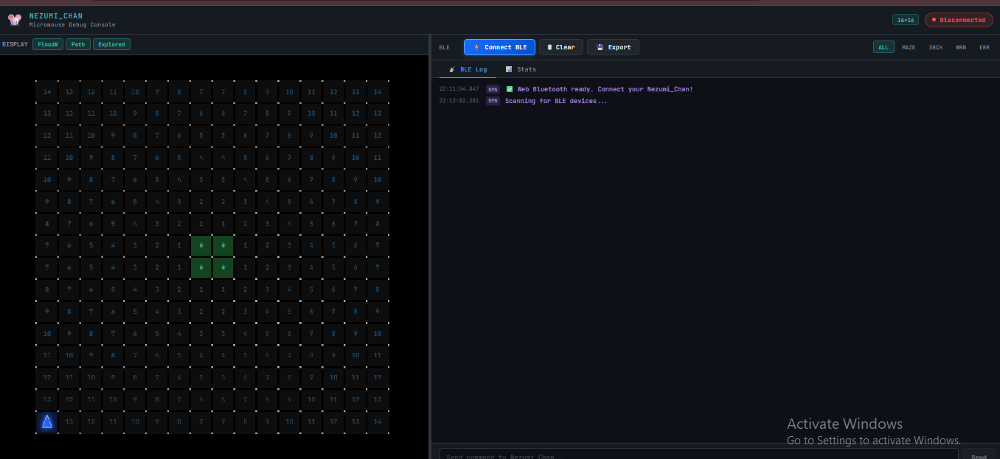

# Host Tools

## IR Sensor Timing Capture

`ir_sensor_timing_capture.py` captures motor-off diagnostic telemetry from
USART1 PA9/PA10 and saves the raw UART stream plus a JSON timing summary:

```powershell
python tools/ir_sensor_timing_capture.py --port COM7 --seconds 30
```

Use the actual USB-UART port and physically disconnect motor VM before the IR
test. See [IR timing validation](../docs/system_debug/IR_SENSOR_TIMING_20261019.md)
for the diagnostic record definitions and acceptance scope. The capture
script requires pyserial (`python -m pip install pyserial`).

## BLE Debug Console

<p align="center">
  
</p>

The `ble_debug_console.html` is a standalone host-side web application designed to:

- Connect to the robot via Web Bluetooth API (JDY-33 BLE module)
- Monitor real-time UART/BLE log streams
- Render live 2D maze walls, flood-fill distance maps, calculated path, and robot pose

### Getting Started

1. Open `ble_debug_console.html` using a Chromium-based browser (Google Chrome or Microsoft Edge).
2. Power on the robot and the JDY-33 BLE module.
3. Click the **Connect BLE** button in the console header.
4. Select the Bluetooth device broadcasting the `0xFFE0` service.

### Notes

- The console is currently synced with the firmware's **5x5 maze configuration**.
- The robot sends `CELL:` packets for incremental step updates and `MAZE:` packets for complete maze dumps.
- If you change the maze dimensions in the firmware, update the corresponding constants in `ble_debug_console.html`.


## Encoder unified qualification (2026-10-20)

Run a complete source/native/build audit, synthetic speed-estimator A/B,
and archived motor-count analysis **without touching hardware**:

    python tools/encoder_qualification_pipeline.py --mode offline

To compile, flash only the dedicated motor-locked encoder firmware,
capture all USART1 diagnostics on COM7 for two minutes, and generate
a single report (requires physically disconnected motor VM):

    python tools/encoder_qualification_pipeline.py --mode full --port COM7 --seconds 120 --confirm-vm-disconnected --flash-motor-off

Outputs are saved in a new results/encoder_qual_* folder, including
REPORT.md, summary.json, raw UART, 1Hz SYS_E CSV, opt-in ~50Hz SYS_EN CSV,
host regression logs, simulated estimator study, and archived PWM review.

The real 33-stage OFF/ON sweep reaches **100% PWM**. It is a separately
gated opt-in, never part of default qualification. Follow the
[Encoder pipeline safety protocol](../docs/encoder/QUALIFICATION_PIPELINE_20261020.md).
